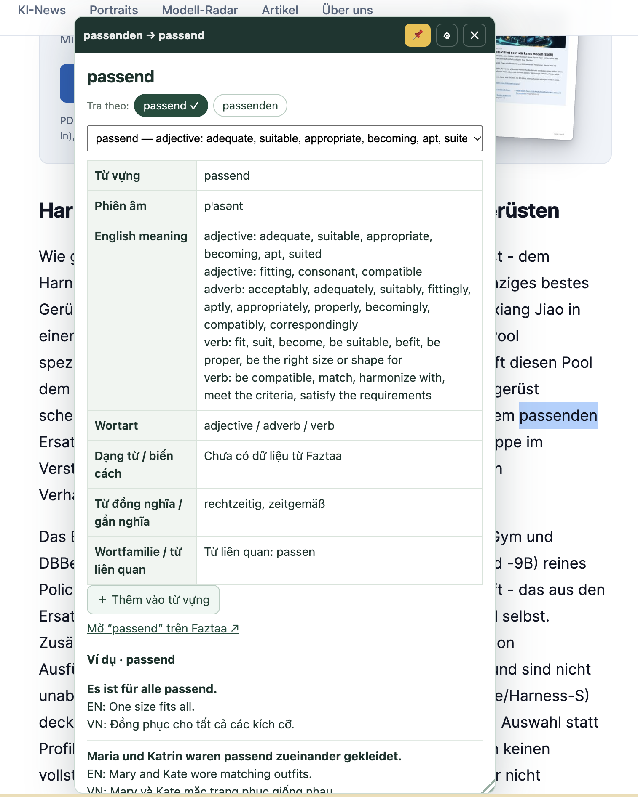
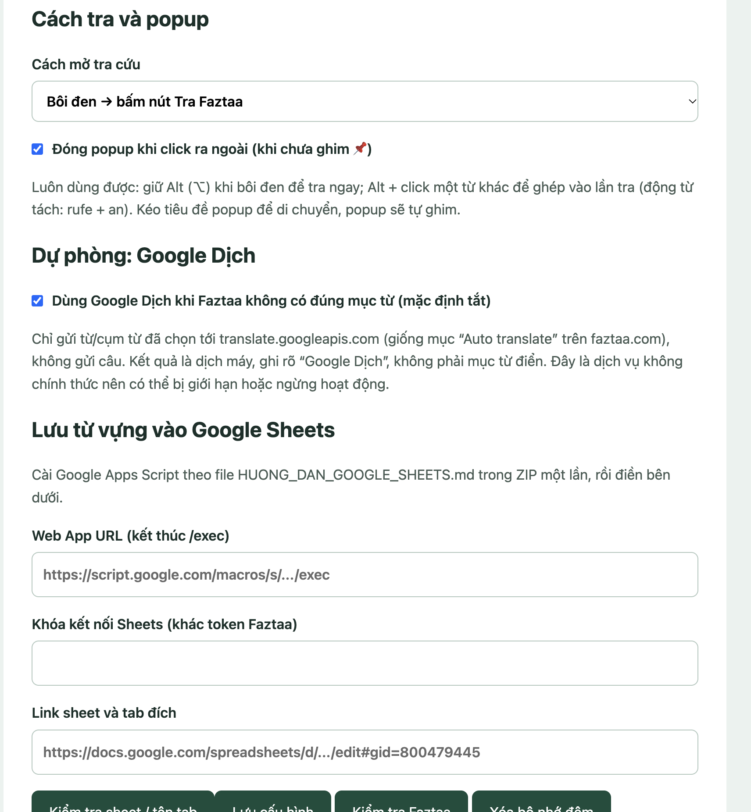

# Deutsch Lens 3.2 — tra từ tiếng Đức bằng Faztaa

Tiện ích (extension) cho Chrome và Edge: bôi đen một từ tiếng Đức trên bất kỳ trang web nào để xem nghĩa tiếng Anh, phiên âm, từ loại, mạo từ, dạng từ, từ đồng nghĩa và câu ví dụ Đức – Anh – Việt từ từ điển **Faztaa**.

Trước khi tra, extension tự phân tích từ ngay trên máy của bạn:

| Bạn bôi đen | Extension tra |
|---|---|
| skaliert, ging, Häuser, gegoogelt | skalieren, gehen, Haus, googeln |
| "rufe" hoặc "an" trong *Ich rufe dich morgen an.* | anrufen (động từ tách) |
| Blogbeitrag, Arbeitsplatz, Krankenhaus | Blog + Beitrag, Arbeit +s Platz, Kranke +n Haus (từ ghép) |
| selbstüberwachtes | selbst + überwachen (tính từ ghép) |

- **Nguồn nghĩa duy nhất là Faztaa.** Không dùng AI, không tự đặt câu, không tự bịa nghĩa.
- **Google Dịch chỉ là dự phòng tùy chọn**, mặc định TẮT, và luôn ghi rõ "Dịch máy · Google Dịch".
- **Chỉ gửi đúng từ bạn chọn** (hoặc các dạng gốc của nó) tới Faztaa. Câu xung quanh chỉ dùng để phân tích trong máy, không gửi đi đâu.

---

## 1. Cài đặt lần đầu

### Bước 1 — Chuẩn bị thư mục
Giải nén ZIP (nếu có) và đặt thư mục ở một chỗ cố định, ví dụ `Documents/deutsch-lens`. **Đừng xóa hay di chuyển thư mục này sau khi cài**, vì trình duyệt chạy extension trực tiếp từ đó.

Thư mục đúng phải có file `manifest.json` ở ngay bên trong.

### Bước 2 — Nạp extension vào trình duyệt
1. Mở trang quản lý extension:
   - Chrome: gõ `chrome://extensions` vào thanh địa chỉ.
   - Edge: gõ `edge://extensions`.
2. Bật **Developer mode / Chế độ nhà phát triển** (công tắc góc trên bên phải ở Chrome, cột bên trái ở Edge).
3. Bấm **Load unpacked / Tải tiện ích đã giải nén** → chọn thư mục ở Bước 1.
4. Thẻ **Deutsch Lens** hiện ra. Bấm biểu tượng ghim (🧩 → 📌) để biểu tượng extension luôn hiện trên thanh công cụ.

Cần Chrome hoặc Edge phiên bản 110 trở lên.

### Bước 3 — Lấy token Faztaa
Extension cần token đăng nhập Faztaa của bạn (giá trị header `authorization`):

1. Mở <https://faztaa.com> và **đăng nhập**.
2. Nhấn **F12** (Mac: **⌥ ⌘ I**) để mở DevTools → chọn tab **Network**.
3. Gõ `api.faztaa.com` vào ô lọc (Filter).
4. Tra một từ bất kỳ trên faztaa.com, ví dụ *Wert*.
5. Bấm vào một dòng yêu cầu vừa hiện ra (ví dụ `Wert?page=1&limit=20`) → mục **Headers** → **Request Headers**.
6. Tìm dòng `authorization:` và sao chép **phần giá trị phía sau**.

Nếu lỡ sao chép cả chữ `authorization: …`, extension sẽ tự bỏ phần đầu.

> Token là thông tin đăng nhập của bạn: không chia sẻ cho ai. Token có thể hết hạn khi bạn đăng xuất. Khi đó làm lại bước này và dán token mới.

### Bước 4 — Nhập token
1. Bấm biểu tượng **Deutsch Lens** trên thanh công cụ. Trang **Cài đặt** sẽ mở ra.
2. Dán token vào ô **Token Faztaa**.
3. Bấm **Lưu cấu hình** → thấy "Đã lưu.".
4. Bấm **Kiểm tra Faztaa**. Nếu đúng, bạn thấy: `Kết nối thành công: der Wert — …`.

### Bước 5 — Tải lại các trang đang mở
Các tab đã mở trước khi cài cần **tải lại (F5)** thì extension mới chạy trên đó.

---

## 2. Cách dùng

1. Bôi đen một từ tiếng Đức trên trang web.
2. Bấm nút **Tra Faztaa** hiện cạnh vùng chọn.
3. Popup hiện ở **giữa màn hình** (lệch lên/xuống nếu cần để không che từ bạn đang tra).

<p align="center">
  
  <br><em>Bôi đen “passenden” → extension nhận ra từ gốc “passend” (✓ = Faztaa có đúng từ này) và hiện nghĩa tiếng Anh, phiên âm, từ loại, từ đồng nghĩa, từ liên quan, nút lưu vào Sheets và câu ví dụ Đức – Anh – Việt.</em>
</p>

**Phím tắt và thao tác nhanh**

| Thao tác | Tác dụng |
|---|---|
| Giữ **Alt (⌥)** khi bôi đen | Tra ngay, không cần bấm nút |
| **Alt + click** một từ khác | Ghép thêm từ đó vào lần tra (ví dụ: tra "rufe" rồi Alt + click "an") |
| **Esc** hoặc **✕** | Đóng popup |
| **←** | Quay lại từ vừa tra trước đó |
| **📌** | Ghim: popup đứng yên khi tra từ mới |
| Kéo **thanh tiêu đề** | Di chuyển popup (tự ghim) |
| Kéo **cạnh / góc** popup | Đổi kích thước theo chiều ngang, dọc hoặc cả hai; cỡ được nhớ cho lần sau |
| **Double-click** vào cạnh popup | Trở về cỡ tự động |

**Trong popup**

- **Tra theo:** các dạng extension đã thử (ví dụ *rufe → anrufen, rufen*). Dấu ✓ nghĩa là Faztaa có đúng từ đó. Nếu máy đoán sai, bấm một dạng khác để tra lại.
- **Từ ghép:** khi Faztaa không có nguyên từ, extension tách từ và tra từng phần. Mục này ghi rõ "ghép từ nghĩa từng phần" vì nó không phải mục từ của Faztaa. Bấm từng phần để xem nghĩa riêng.
- **Động từ + giới từ:** khoảng 150 động từ thường gặp (ví dụ *warten auf + Akk*). Có ✓ nếu giới từ đó xuất hiện trong câu.
- **Xem thêm ví dụ:** tải thêm câu ví dụ mà không làm mất phần nghĩa.
- **＋ Thêm vào từ vựng:** lưu từ vào Google Sheets (xem mục 4).

---

## 3. Các tùy chọn trong trang Cài đặt

Mở trang Cài đặt bằng cách bấm biểu tượng Deutsch Lens trên thanh công cụ, hoặc bấm nút ⚙ trên popup.

<p align="center">
  
  <br><em>Phần “Cách tra và popup”, “Dự phòng: Google Dịch” và “Lưu từ vựng vào Google Sheets” trong trang Cài đặt.</em>
</p>

| Tùy chọn | Ý nghĩa |
|---|---|
| **Phạm vi** | *Mọi website* (mặc định) · *Chỉ website đã chọn* · *Chỉ cuộc chat/trang đã chọn*. Hai chế độ sau cần dán URL vào ô bên dưới. |
| **Cách mở tra cứu** | *Bôi đen → bấm nút* (mặc định) · *Double-click là tra ngay* · *Bôi đen là tra ngay* |
| **Đóng popup khi click ra ngoài** | Mặc định tắt: popup chỉ đóng khi bấm ✕ hoặc Esc |
| **Dùng Google Dịch khi Faztaa không có đúng mục từ** | Mặc định tắt (xem bên dưới) |
| **Kiểm tra Faztaa** | Thử tra "Wert" để kiểm tra token |
| **Xóa bộ nhớ đệm** | Xóa kết quả đã lưu tạm (mặc định giữ 15 phút) |

**Chỉ bật trong một cuộc chat:** chọn *Chỉ cuộc chat/trang đã chọn* → dán URL đầy đủ, ví dụ `https://chatgpt.com/c/abc123` → Lưu. Extension chỉ so sánh tên miền và đường dẫn (bỏ phần `?…` và `#…`). Nó vẫn chỉ gửi từ bạn chọn, không gửi nội dung cuộc chat.

### Google Dịch dự phòng
Faztaa không có mọi từ. Ví dụ, *selbstüberwachtes* không có trong từ điển. Dòng "self-monitored" bạn thấy trên faztaa.com thực ra là mục "Auto translate" của Google.

Để dùng nguồn này:
1. Cài đặt → tích **Dùng Google Dịch khi Faztaa không có đúng mục từ**.
2. Bấm **Lưu cấu hình** → trình duyệt hỏi quyền truy cập `translate.googleapis.com` → **Cho phép**. Nếu bạn từ chối, tính năng thường vẫn chạy.

Khi bật:
- Google chỉ được gọi khi Faztaa **không có đúng** mục từ. Từ nào Faztaa có thì không gọi Google.
- Popup hiện thêm khung vàng **"Dịch máy · Google Dịch — không phải mục từ của Faztaa"** với nghĩa tiếng Anh (EN) và tiếng Việt (VN).
- Chỉ gửi đúng từ đã chọn, không gửi câu.
- Đây là dịch vụ không chính thức của Google nên có thể bị giới hạn hoặc ngừng bất cứ lúc nào.

---

## 4. Lưu từ vựng vào Google Sheets (tùy chọn)

Nút **＋ Thêm vào từ vựng** ghi từ đang xem vào cuối một tab Google Sheets với 5 cột:

> Từ vựng · Phiên âm · Nghĩa tiếng Anh · Từ đồng nghĩa / gần nghĩa · Đặt câu

Cách kết nối (chỉ làm một lần, không cần API key):
1. Trong file Google Sheets: **Tiện ích mở rộng → Apps Script** → dán nội dung file `Code.gs` (cùng thư mục này) → Lưu.
2. **Project Settings → Script properties**, thêm:
   - `SPREADSHEET_ID`
   - `SHEET_GID`
   - `SHARED_SECRET`: chuỗi ngẫu nhiên dài ít nhất 32 ký tự, khác token Faztaa.
3. **Deploy → New deployment → Web app**, chọn *Execute as: Me* và *Who has access: Anyone*. Sao chép URL kết thúc bằng `/exec`.
4. Trong Cài đặt extension, điền:
   - **Web App URL**
   - **Khóa kết nối Sheets**
   - **Link sheet và tab đích**

   Sau đó bấm **Lưu cấu hình** và cho phép hai tên miền Google Script khi được hỏi.
5. Bấm **Kiểm tra sheet / tên tab**. Nút này chỉ kiểm tra kết nối, không ghi dữ liệu.

Hướng dẫn chi tiết từng bước nằm trong **HUONG_DAN_GOOGLE_SHEETS.md**.

Từ bị trùng (so theo cột A) sẽ không được thêm lần nữa. Khi chỉ có kết quả Google Dịch, nghĩa được ghi là `[Google Dịch] …`.

---

## 5. Cập nhật lên phiên bản mới
1. Chép đè các file mới vào **đúng thư mục cũ**.
2. Vào `chrome://extensions` (hoặc `edge://extensions`) → bấm **⟳ Reload** trên thẻ Deutsch Lens. Token và cài đặt được giữ nguyên.
3. Tải lại các trang web đang mở.

Nếu bạn gỡ extension rồi cài lại (Load unpacked), bạn phải nhập lại token và cài đặt.

---

## 6. Gặp lỗi?

| Hiện tượng | Cách xử lý |
|---|---|
| Popup báo chưa có token, kèm nút **Mở Cài đặt** | Làm Bước 3–4 ở mục 1 |
| "Faztaa từ chối truy cập (HTTP 401/403). Kiểm tra token." | Lấy token mới từ faztaa.com, dán lại, Lưu |
| Bôi đen mà không thấy nút **Tra Faztaa** | Tải lại trang (F5). Kiểm tra **Phạm vi** trong Cài đặt. Một số trang không cho chạy extension (xem bên dưới). |
| "Extension vừa được cập nhật. Hãy tải lại trang này." | Tải lại trang (F5) |
| "Chưa tìm thấy mục từ…" | Bấm một dạng khác ở hàng **Tra theo**, hoặc bật Google Dịch dự phòng |
| "Tra cứu quá nhanh. Hãy thử lại sau." (lỗi 429) | Chờ một lúc rồi thử lại |
| Popup quá nhỏ hoặc quá to | Kéo cạnh/góc để chỉnh, hoặc double-click vào cạnh để về cỡ tự động |
| Lưu vào Sheets bị lỗi | Bấm **Kiểm tra sheet / tên tab**. Xem phần "Lưu ý" trong HUONG_DAN_GOOGLE_SHEETS.md. |

**Những nơi extension không chạy:**
- trang nội bộ của trình duyệt (`chrome://…`, `edge://…`) và cửa hàng tiện ích;
- trình xem PDF;
- chữ bên trong ô nhập liệu (input, textarea).

Extension không tự nhận diện tiếng Đức. Bạn cần chọn đúng từ hoặc cụm từ, tối đa 120 ký tự.

---

## 7. Quyền riêng tư và dữ liệu

- **Faztaa:** `api.faztaa.com` chỉ nhận từ bạn chọn và các dạng gốc của từ đó, gửi sau khi bạn bấm tra.
- **Google Dịch:** chỉ được dùng khi bạn tự bật, và cũng chỉ nhận đúng từ.
- **Google Sheets:** chỉ nhận 5 ô của từ bạn bấm lưu.
- **Câu xung quanh** chỉ dùng để phân tích trong máy, không bao giờ gửi đi.
- **Token Faztaa** lưu trong bộ nhớ riêng của extension (`chrome.storage.local`, mức `TRUSTED_CONTEXTS`). Các trang web không đọc được token, và token không nằm sẵn trong mã nguồn.
- **Bộ nhớ đệm:** tối đa 300 kết quả, giữ 15 phút, chỉ nằm trong bộ nhớ. Bấm **Xóa bộ nhớ đệm** để xóa ngay.
- **Phân tích tiếng Đức** dùng dữ liệu có sẵn trong thư mục `data/` (nguồn: `data/NGUON_DU_LIEU.txt`).

**Giới hạn của phần phân tích:**
- Từ gốc của từ hiếm hoặc đa nghĩa có thể bị đoán sai. Khi đó dùng hàng **Tra theo**.
- Từ ghép chuyên ngành có thể bị tách khác ý bạn. Bạn luôn có thể tra từng phần.
- Danh sách động từ + giới từ chỉ có khoảng 150 động từ.

---

## 8. Dành cho người phát triển

**Cấu trúc thư mục**

| File | Vai trò |
|---|---|
| `manifest.json` | Khai báo extension (Manifest V3) |
| `background.js` | Service worker: gọi Faztaa (và Google Dịch nếu bật), cache, phạm vi, Sheets |
| `german.js` | Bộ phân tích tiếng Đức: từ gốc, động từ tách, từ ghép, tách câu |
| `adapter.js` | Chuyển dữ liệu thô của Faztaa sang dạng gọn |
| `content.js` | Nút "Tra Faztaa" và popup (Shadow DOM đóng) trên trang web |
| `options.html`, `options.js`, `options.css` | Trang Cài đặt |
| `data/` | Dữ liệu từ gốc và tần suất |
| `Code.gs`, `HUONG_DAN_GOOGLE_SHEETS.md` | Phần Google Sheets |
| `test/` | Kiểm thử (có thể bỏ khi đóng gói) |

**API Faztaa** (header `authorization: <token>`):
```
GET https://api.faztaa.com/api/search/en/devi/{word}?page=1&limit=20
GET https://api.faztaa.com/api/search/list/example/en/{word}?page={n}&limit=10
```
Loại tra là `devi` và ngôn ngữ là `en` đúng như API thật trả về. **Không đổi thành `word`/`deen`.**

**Chạy kiểm thử**
```bash
# Bộ phân tích tiếng Đức (Node, 37 trường hợp)
node test/german.test.js

# Giao diện (Playwright nạp extension, giả lập api.faztaa.com, không cần token thật; 25 trường hợp)
PW_EXPERIMENTAL_SERVICE_WORKER_NETWORK_EVENTS=1 NODE_PATH=<thư mục node_modules có playwright> node test/ui.test.js
```
Đặt thêm `HEADED=1` để xem trình duyệt chạy.

---

## 9. Lịch sử thay đổi

### 3.2.1
- Popup **căn giữa màn hình theo chiều ngang** và nằm giữa theo chiều dọc. Nó chỉ lệch lên hoặc xuống khi đặt giữa sẽ che mất từ đang tra.
  - Trước đây popup neo ngay dưới từ và kéo dài tới đáy màn hình.
  - Vị trí được căn lại khi nội dung tải xong. Nếu bạn đã kéo, đổi cỡ hoặc ghim popup thì vị trí được giữ nguyên.

### 3.2.0 — Google Dịch dự phòng (mặc định tắt)
- Khung "Dịch máy · Google Dịch" với nghĩa EN và VN, chỉ hiện khi Faztaa không có đúng mục từ. Quyền `translate.googleapis.com` là quyền tùy chọn.
- Vẫn lưu được vào Sheets khi chỉ có kết quả Google Dịch.
- Từ ghép mà không phần nào có trên Faztaa không còn hiện mục "ghép" trống.
- Tính từ ghép giữ chữ thường (selbstüberwachtes).
- Trang Cài đặt xin các quyền tùy chọn trong một lần.

### 3.1.0
- **Đổi cỡ popup** bằng cạnh hoặc góc, và cỡ được nhớ cho lần sau. Click vào tiêu đề không còn tự ghim popup. Popup không tràn khỏi màn hình.
- **Tính từ / phân từ ghép:**
  - selbstüberwachtes → selbst + überwachen; umweltfreundliche → Umwelt + freundlich.
  - Giữ Fugenelement: Arbeit +s Platz.
  - Datenschutzerklärung giữ "Daten" (trước đây tách thành "Datum").
- **Động từ tách chặt hơn:**
  - "Er macht das gut" không còn ra gutmachen.
  - "auf zu viel Arbeit" không còn ra aufhaben.
  - Khi từ xuất hiện nhiều lần trong câu, chọn đúng lần gần chỗ bôi đen.
- **Dạng từ:** "geht’s" → gehen; "Arbeits-" → Arbeit; E-Mail-Adressen → E-Mail-Adresse.
- **Tách câu** hiểu chữ viết tắt (z. B., Dr., usw.) và ngày tháng (am 3. Mai).
- **Chạy ổn trên nhiều loại trang:** Shadow DOM, iframe (khung chat, trình soạn email), banner cookie chặn sự kiện, chữ có dấu tách rời (văn bản từ macOS).
- **Bấm nút trong popup** (ví dụ "Xem thêm ví dụ") không còn làm tra lại hoặc làm hiện lại nút "Tra Faztaa".
- **Nút ←** khôi phục đúng các từ đã ghép bằng Alt + click.
- **Hai lần tra liên tiếp:** kết quả của lần tra cũ không đè lần mới.
- **Kiểm tra Faztaa** không còn báo thành công giả. Lỗi mạng và lỗi token có thông báo tiếng Việt. Lỗi ở một dạng từ không chặn các dạng khác.
- **Bảo mật token:** token luôn được khóa ở mức `TRUSTED_CONTEXTS` mỗi lần extension khởi động.
- **Tốc độ:** dữ liệu từ điển dùng ít bộ nhớ hơn (khoảng 150 MB → 40 MB) và khởi động nhanh hơn (khoảng 0,5 giây → 50 ms).

### 3.0.1
- Sửa lỗi `toLowerCase` khi chưa có token. Nay hiện thông báo kèm nút **Mở Cài đặt**.
- Ersatzgerüste → Ersatzgerüst → Ersatz + Gerüst.
- Bỏ gạch nối mềm trong từ được chọn.

### 3.0
- Phân tích tiếng Đức ngay trong máy trước khi tra: từ gốc, động từ tách, từ ghép, động từ + giới từ.
- Có các chế độ mở tra cứu, ghim popup và nút ←.

### 2.1
- Nút **Thêm vào từ vựng** → Google Sheets qua Apps Script.
